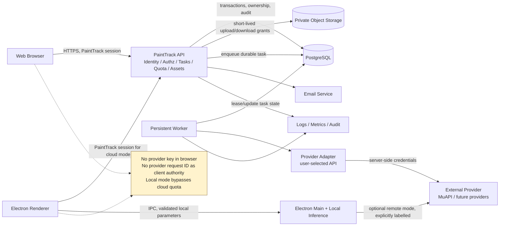
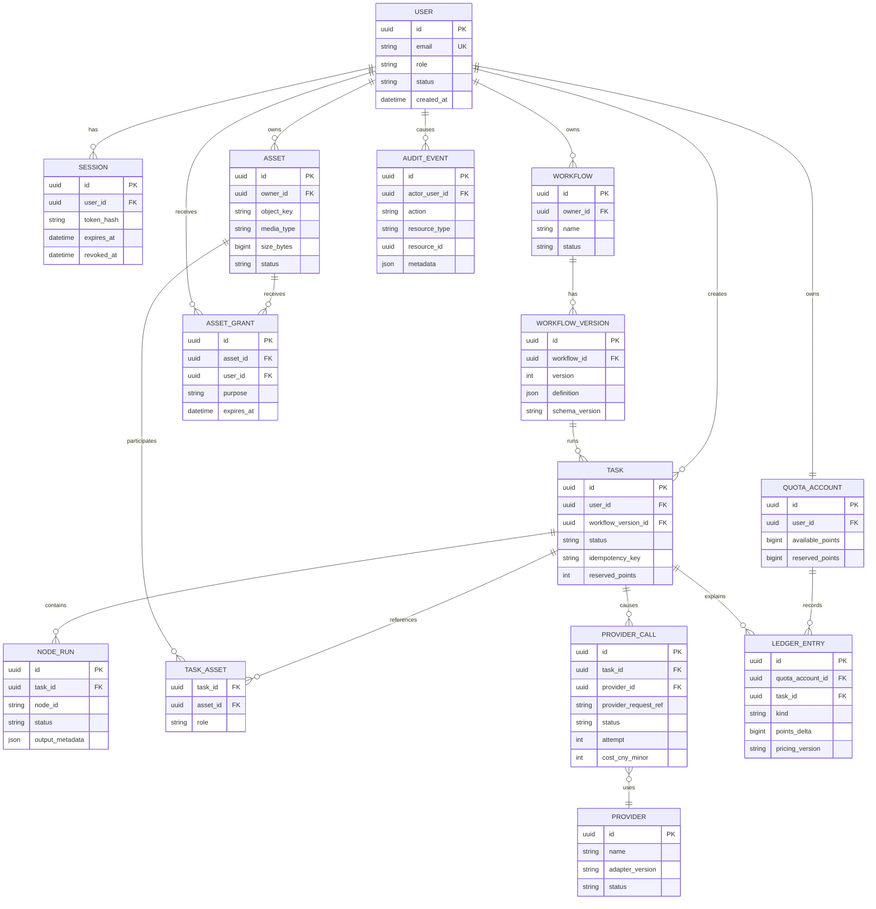
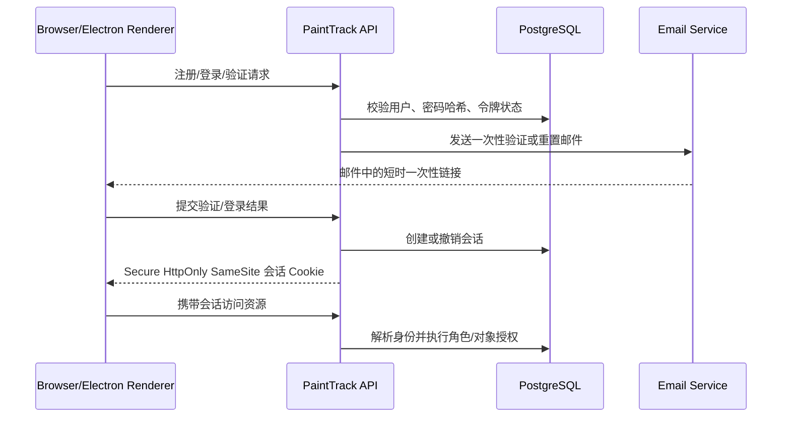
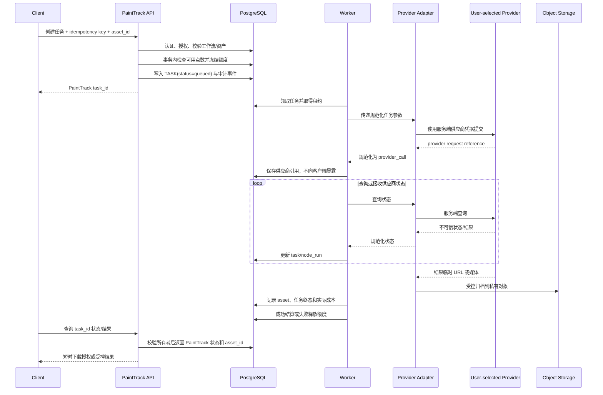

# 阶段 1 小步骤 3：架构、数据流、服务边界与威胁模型

- 日期：2026-11-04
- 项目：PaintTrack
- 步骤：阶段 1 小步骤 3
- 范围：初版组件架构、概念数据模型、身份/任务/文件/密钥/供应商数据流、服务边界与威胁模型
- 方法：基于阶段 1 小步骤 1 能力盘点、阶段 1 小步骤 2 Vibe-Workflow 审查和已确认产品基准进行设计；不修改业务源码，不锁定尚未确认的基础设施供应商或数据库访问工具

## 1. 目标与范围

本步骤把前两步的源码观察转换为可执行的 SaaS 设计边界，回答以下问题：

1. 哪些组件属于 PaintTrack 自有的可信控制面？
2. 哪些组件只负责执行、存储或供应商适配，不能成为用户授权的权威？
3. 用户身份、工作流、任务、文件、供应商密钥和额度如何流转？
4. SSRF、对象级越权、重放、资源/成本滥用、文件滥用、表达式滥用和供应商故障如何进入设计？
5. 哪些决策已经足够明确，哪些仍必须在阶段 1 小步骤 4/5 中经用户确认？

本报告是架构基线，不是实现承诺，也不代表已完成动态安全测试、数据库迁移、认证或基础设施部署。

## 2. 已确认基准与未决选型

### 2.1 本步骤沿用的已确认基准

- Web SaaS 是主要产品，Electron 是辅助客户端。
- PaintTrack 自建服务端负责身份、权限、任务、额度、供应商密钥和数据归属。
- 云端任务使用“检查余额 → 冻结额度 → 提交生成 → 成功结算 / 失败释放”语义。
- 供应商失败自动重试一次；重试必须幂等，不能重复扣费或无控制地创建任务。
- 首期邮箱登录，普通用户与管理员角色；角色模型需允许未来扩展。
- 数据库基准为 PostgreSQL；文件基准为对象存储；供应商 URL 仅作临时地址，不能作为长期资产地址。
- 供应商调用通过服务端 Provider Adapter 和独立 Worker 执行；首个 Provider 由用户按当前产品目标确认，不预设 MuAPI。
- 用户界面展示点数，后台记录人民币供应商成本；计费规则必须版本化。
- Electron 的 sd.cpp、Wan2GP 本地推理不扣平台额度，并且不进入云端任务和账务路径。
- Vibe-Workflow 的画布和协议可作为参考，但不能直接作为生产 SaaS 执行后端。

### 2.2 本步骤明确不做的最终选型

以下决策保留到后续评估，不在本报告中擅自锁定：

| 领域 | 当前边界 | 后续决策要求 |
|---|---|---|
| PostgreSQL 访问/迁移 | 必须可迁移、可审查、可回滚 | 比较 ORM/query builder、迁移工具、事务和测试数据库方案 |
| 对象存储 | 使用 S3 兼容抽象，默认私有 | 比较供应商、区域、生命周期、带宽、合规和恢复能力 |
| 队列 | 持久化任务表 + 独立 Worker 为硬要求 | 比较数据库领取、Redis/BullMQ 等方案的持久性、运维和许可 |
| 邮件服务 | 邮箱登录需要可交付邮件 | 比较服务商、发信域名、退信处理、地区和成本 |
| 部署环境 | Web/API、Worker、PostgreSQL、对象存储需可独立运行 | 比较托管容器、数据库、网络、备份、监控和密钥管理 |
| 实时状态 | 首期可保留 PaintTrack ID 轮询 | 评估轮询、SSE 或 WebSocket 的成本和运维复杂度 |
| 内容安全 | 首期限制明显违法、侵权和敏感内容 | 上线前按目标地区、供应商政策和运营责任确认 |

## 3. 初版组件架构



### 3.1 组件职责

| 组件 | 负责 | 不负责 / 不得成为权威 |
|---|---|---|
| Web Browser | 展示界面、提交用户意图、读取 PaintTrack 任务和资产状态 | 不持有长期供应商 key；不决定额度、所有者、最终任务状态或对象访问权 |
| Electron Renderer | 云端模式的 UI；本地模式的用户交互 | 不直接持有服务端秘密；不把本地模式伪装成云端计费任务 |
| Electron Main / Local Inference | sd.cpp、Wan2GP 本地推理，进度和取消 | 不写入云端额度账本；远程 MCP 必须显式标记第三方数据流 |
| PaintTrack API | 身份认证、对象授权、输入校验、任务创建、额度协调、资产授权、审计 | 不执行长时间供应商调用；不信任客户端状态或供应商返回数据 |
| PostgreSQL | 用户、会话、工作流、任务、节点运行、额度账本、资产元数据、供应商调用和审计的事务权威 | 不保存大文件；不接受客户端直写 |
| Object Storage | 私有原始素材和生成结果的长期存储 | 不自行决定用户是否有权读取；公开 CDN URL 不作为授权机制 |
| Persistent Worker | 领取任务、租约、Provider 调用、重试、结果归档、终态更新 | 不绕过 API 的授权/额度规则；不将内存状态作为唯一任务记录 |
| Provider Adapter | 参数映射、提交、查询、取消（若支持）、结果解析和错误分类 | 不向浏览器暴露供应商凭据；不改变 PaintTrack 账务事实 |
| External Provider | 实际生成或供应商侧临时文件服务 | 不被视为 PaintTrack 用户、任务或资产的权威；响应按不可信输入处理 |
| Email Service | 发送验证、登录或重置邮件 | 不成为 PaintTrack 会话授权的唯一数据库；密钥不得进客户端 |
| Logs/Metrics/Audit | 关联 ID、运行指标、安全审计和成本观测 | 不记录密码、完整令牌、供应商 key、原始 prompt/素材或不必要的个人数据 |

## 4. 服务边界与信任边界

### 4.1 边界定义

| 边界 | 进入边界的数据 | 必须执行的控制 |
|---|---|---|
| B1 浏览器 / PaintTrack API | Cookie、请求 JSON、上传会话、工作流定义、任务操作 | HTTPS；会话认证；CSRF 策略；schema 校验；限流；幂等键；对象级授权；错误脱敏 |
| B2 API / 数据库 | 用户、任务、额度、资产和审计写入 | 参数化查询；事务；唯一约束；最小数据库权限；状态机约束；不可变账本事件；审计 |
| B3 API / 对象存储 | 上传授权、完成确认、短时下载授权 | 私有 bucket；服务端生成 key；大小/MIME/魔数校验；所有权校验；短时 URL；生命周期 |
| B4 API / Worker | 持久任务、租约、重试和取消 | 任务状态机；租约/心跳；幂等键；有限重试；超时；崩溃恢复；重复消息安全 |
| B5 Worker / Provider | Provider 请求、临时 URL、响应和错误 | 服务端密钥；固定 adapter；禁止任意 URL 代理；请求/响应大小限制；超时；错误分类；日志脱敏 |
| B6 用户内容 / 媒体解析器 | 图片、视频、音频、压缩包或供应商结果 | 类型和大小校验；解析隔离；恶意内容策略；不可信媒体不进入高权限进程 |
| B7 Electron Renderer / Main | IPC 参数、路径、远程模式配置、模型输出 | IPC 白名单；参数校验；路径限制；日志脱敏；本地/远程模式清晰分流 |
| B8 PaintTrack / 外部邮件服务 | 邮箱地址、验证令牌、邮件状态 | 令牌短时且一次性；最小数据；供应商密钥仅服务端配置；失败可重试但不泄露账户状态 |

### 4.2 权威性原则

1. PaintTrack 用户身份以服务端会话和数据库用户记录为准，不以 localStorage、sessionStorage、embed code 或客户端 token 为准。
2. PaintTrack 任务状态以数据库任务和节点运行记录为准，不以浏览器轮询缓存或供应商 request ID 为准。
3. PaintTrack 资产身份以内部 `asset_id` 和所有者记录为准，不以供应商 CDN URL、对象 key 或客户端文件名为准。
4. 额度余额以账本事件和可重算余额为准，不以客户端显示值、隐藏字段或单个可写余额字段为准。
5. 本地推理结果属于 Electron 本地流程，不自动进入云端任务、额度账本或云端资产，除非用户明确发起上传/云端任务。

## 5. 概念 ERD



### 5.1 数据不变量

- 任一 `WORKFLOW`、`TASK`、`ASSET`、`SESSION` 和 `QUOTA_ACCOUNT` 的读取/修改必须能够追溯到用户或管理员授权。
- `TASK.idempotency_key` 至少在用户作用域内唯一；重复创建请求返回同一任务或确定性冲突，不产生第二次冻结。
- 任务只能按定义的状态机转换；终态不可被普通重试重新打开。
- `LEDGER_ENTRY` 追加写入并关联任务或管理员审计；余额可由账本重算，不能只依赖客户端或无审计的余额覆盖。
- 供应商失败重试必须与 `PROVIDER_CALL.attempt` 和账务状态绑定；同一逻辑任务不得因 Worker 重启重复扣费。
- `ASSET.object_key` 由服务端生成，包含不可猜测的用户/资产作用域；客户端文件名不决定对象路径。
- `ASSET` 默认私有；下载必须验证用户、共享授权或管理员权限，并使用短时授权。
- 工作流版本保存 schema 快照或等价版本信息，历史任务不因供应商 schema 无通知变化而改变语义。

## 6. 核心数据流

### 6.1 身份与会话流



控制要点：邮件令牌短时、一次性、只保存 hash；登录和重置限速；错误响应避免泄露邮箱是否存在；管理员操作必须写审计事件。

### 6.2 云端任务、额度与供应商流



失败路径：

- 供应商可重试的暂时失败：保留同一 `TASK`，递增尝试号，遵守最大次数和退避；账务不重复冻结。
- 供应商不可重试或超过上限：任务进入明确失败终态，释放冻结额度，并记录分类错误。
- Worker 崩溃：租约过期后恢复领取；依据幂等键和 provider 状态查询避免重复创建不可控任务。
- 归档失败：不能把“供应商成功”直接当作“PaintTrack 资产可用”；任务进入可处置的归档失败状态，账务结算规则必须明确并审计。

### 6.3 文件上传与下载流

```mermaid
flowchart TD
    B[Client selects file]
    A[API authenticates and validates intent]
    D[(DB asset + upload session)]
    O[(Private Object Storage)]
    V[Upload completion validation]
    P[Provider Adapter]
    DL[Short-lived authorized download]

    B -->|filename, declared type, size| A
    A -->|create asset/upload session| D
    A -->|constrained signed upload| B
    B -->|direct upload with scoped key| O
    B -->|complete upload(asset_id)| A
    A --> V
    V -->|metadata/magic/type/size checks| O
    V -->|mark ready or reject/quarantine| D
    D -->|authorized asset reference| P
    D -->|owner/share check| DL
    DL --> O
    O --> DL
```

文件路径和临时 URL不构成授权。供应商返回的 URL 如需抓取，必须经过固定 Provider Adapter 的目标限制、解析、DNS/重定向策略、超时和响应大小限制；禁止提供通用“传入任意 URL 并由服务器代取”的接口。

### 6.4 工作流表达式与文件引用

工作流定义保存为版本化 JSON，但执行时必须由服务端重新规范化：

1. 验证节点数量、边数量、节点类型白名单、schema 版本和字段大小。
2. 验证每条边的源节点/目标节点存在，输入输出端口合法且类型兼容。
3. 检测环路、递归深度、表达式长度和引用数量。
4. 只解析受限引用，例如 `{{ node.outputs[0].value }}` 的兼容子集；禁止任意 JavaScript、模板函数、网络请求、文件系统访问或代码执行。
5. 将引用解析结果绑定到已授权的任务输入/资产，不接受客户端直接注入供应商 URL 或内部对象 key。
6. 运行过程中限制节点数、并发、总时长、输出大小和成本。

## 7. 威胁模型

### 7.1 资产与攻击者

**需要保护的资产：**用户身份和会话、工作流定义、原始素材、生成结果、额度和账本、供应商密钥、供应商 request reference、成本数据、管理员操作和审计记录。

**主要攻击者/故障来源：**未登录攻击者、普通用户越权、恶意或被盗会话、恶意工作流/媒体、重复请求脚本、被攻陷的供应商返回、故障或重启的 Worker、外部 URL/重定向、误配置的管理员和本地 Electron 远程模式。

### 7.2 威胁与控制矩阵

| 威胁 | 入口/后果 | 设计控制 | 验证要求 | 优先级 |
|---|---|---|---|---|
| 对象级越权（IDOR） | 猜测 task/asset/workflow ID 读取或修改他人数据 | 每次读取、修改、下载都按用户/共享授权查询；ID 仅作定位不作授权 | 两个用户交叉访问、伪造 ID、管理员边界测试 | 阻断 |
| SSRF / 重定向 | 服务器抓取内网、云元数据或任意大响应 | Provider Adapter 固定目标；URL allowlist；禁止用户任意 URL 代理；限制 DNS/重定向/响应大小/超时 | localhost、内网地址、IPv4/IPv6、DNS 重绑定、重定向链测试 | 阻断 |
| 供应商密钥泄露 | 浏览器、Electron、日志或错误响应暴露 key | 仅服务端配置读取；请求封装隔离；日志脱敏；错误映射 | bundle、网络、存储、日志和异常响应扫描 | 阻断 |
| 任务重放/重复扣费 | 重复点击、网络重试、消息重复导致多次任务或冻结 | 用户作用域幂等键；唯一约束；事务冻结；Provider 调用 attempt 记录 | 并发重复 POST、Worker 重启、重复消息测试 | 阻断 |
| 额度竞态/账本破坏 | 并发任务超扣、客户端指定金额、错误释放 | 事务、行锁或等价并发控制；服务端计价；不可变账本；可重算余额 | 并发余额边界、重复结算、负数/溢出/伪造用户 ID | 阻断 |
| 资源/成本滥用 | 大工作流、并发任务、长轮询或高价模型耗尽资源 | 节点/边/body/输出/时长/并发/每日成本限制；模型白名单；限流 | 大小边界、并发、超时、队列积压和成本上限测试 | 高 |
| 文件滥用 | 超大文件、伪造 MIME、恶意媒体、跨用户读取 | 服务端大小/魔数/类型校验；私有对象；解析隔离；配额和生命周期 | MIME 欺骗、恶意媒体、过期链接、跨用户下载测试 | 阻断 |
| 工作流表达式注入 | 任意模板、循环、深度递归或代码执行 | 受限 parser；节点/引用/深度上限；无 eval；服务端重算和类型校验 | 代码片段、循环、超长表达式、跨工作流引用测试 | 阻断 |
| 供应商响应污染 | 恶意错误、URL、状态或超大结果进入系统 | 响应 schema 校验；错误分类；URL 不可信；大小/超时限制；脱敏 | 伪造 4xx/5xx、异常 JSON、恶意 URL、迟到结果 | 高 |
| 会话/CSRF/登录滥用 | 会话盗用、跨站操作、暴力登录 | Secure HttpOnly SameSite Cookie；CSRF 策略；限速；撤销和过期；邮箱令牌一次性 | Cookie 属性、跨站请求、暴力、过期/撤销测试 | 阻断 |
| 管理员误操作或越权 | 充值、重试、供应商配置导致成本/数据影响 | 独立角色策略；二次确认；最小权限；审计；高风险操作限额 | 普通用户访问、高风险重复操作、审计完整性测试 | 高 |
| 云端/本地路径混淆 | 本地推理错误扣费或远程模式隐式上传 | UI 和调用链显式模式；本地分支不调用云端账务；远程 MCP 明示第三方 | Electron mock 断言本地不触发 API/账务，远程路径单独测试 | 高 |
| 日志与隐私泄露 | prompt、令牌、媒体 URL 或个人信息进入日志 | 结构化日志白名单；敏感字段脱敏；短保留；访问控制 | 日志 fixture 扫描和异常路径检查 | 高 |
| Worker 故障/状态丢失 | 任务卡住、重复执行、结果丢失 | 持久任务表；租约、心跳、超时、恢复；终态幂等 | kill/restart、租约过期、迟到结果、重复领取测试 | 阻断 |

### 7.3 风险处理顺序

1. 在数据库、认证、Worker 和 Provider Adapter 实现前，先把阻断项写入接口与不变量；不能依赖后期补丁。
2. 先用 mock Provider 验证任务、额度、重试、对象授权和状态机，再接入经用户确认的自定义 API Provider；不预设 MuAPI。
3. 文件和供应商 URL 控制必须作为服务端边界，不接受“前端已经检查过”作为安全理由。
4. 本地 Electron 路径与云端路径必须分别测试，并在日志和 UI 中可区分。
5. 上线前将高危项转为可执行测试；任何阻断项未验证不得进入真实高成本供应商或生产发布。

## 8. 初版 ADR

### ADR-001：PaintTrack API 作为唯一云端业务入口

- **状态：**已确认基准，待实现
- **决策：**浏览器和 Electron 云端模式只调用 PaintTrack 自有 API；供应商调用由服务端 Worker/Provider Adapter 承担。
- **原因：**统一身份、对象授权、额度、审计、限流和错误边界；避免浏览器持有供应商 key 和 provider request ID。
- **影响：**现有 MuAPI 透明代理、客户端 key 和浏览器轮询需迁移；前端改为使用 PaintTrack task_id。
- **替代方案：**客户端直连供应商；因无法可靠实现密钥、额度和所有权控制而拒绝。

### ADR-002：任务状态持久化并由独立 Worker 执行

- **状态：**已确认基准，待队列方案评估
- **决策：**任务事实写入 PostgreSQL，Worker 使用租约/心跳处理，失败可恢复，重试有上限。
- **原因：**生成任务跨请求、跨进程且可能长时间运行；浏览器轮询不能承担可靠性。
- **影响：**需要任务状态机、幂等键、Provider 调用记录和运维监控。
- **未决：**具体队列/领取实现、Worker 部署和告警方案。

### ADR-003：供应商临时地址不作为长期资产身份

- **状态：**已确认基准，待对象存储选型
- **决策：**使用内部 `asset_id` 和私有对象存储归档；下载经过授权和短时链接。
- **原因：**供应商 CDN 生命周期、权限和可用性不可由 PaintTrack 控制。
- **影响：**需要上传会话、完成确认、结果归档、生命周期清理和存储成本治理。

### ADR-004：云端额度与本地推理分账

- **状态：**已确认基准
- **决策：**云端任务走冻结/结算/释放账务；Electron sd.cpp/Wan2GP 本地推理不扣平台额度。
- **原因：**本地计算资源不经过 PaintTrack 供应商成本链；避免产品语义和账务混淆。
- **影响：**调用链、UI 状态、日志和测试必须能识别 local/cloud/remote 三种模式；远程 MCP 需单独告知数据外传。

### ADR-005：工作流定义版本化，服务端重新校验

- **状态：**设计决策，待工作流实施阶段确认协议细节
- **决策：**保存版本化定义和 schema 快照；执行前服务端验证节点、边、类型、表达式、循环和资源预算。
- **原因：**当前协议由前端组件和远程 schema 共同决定，无法直接作为安全执行协议。
- **影响：**Vibe-Workflow 主要复用 UI；任意代码节点、任意 URL 代理和不受限模板执行不纳入首期。

## 9. 未决事项与下一步门禁

### 9.1 必须在阶段 1 小步骤 4/5 决定

- PostgreSQL 访问层、迁移工具和测试数据库策略；
- 对象存储供应商、区域、私有访问、生命周期和备份恢复；
- 任务领取/队列方案、Worker 部署、租约和监控；
- 邮件服务、域名、验证/退信和地区要求；
- 部署环境、网络隔离、密钥管理、日志/指标平台；
- 数据分类、保留期限、删除/导出、备份加密和恢复目标；
- 首期任务状态实时同步方式；
- 目标上线地区、适用内容政策和运营责任人。

### 9.2 不得在本步骤后直接实施的内容

- 不得直接创建 PostgreSQL 表、迁移或 ORM 配置；
- 不得直接实现邮箱认证、会话或管理员账号；
- 不得接入真实高成本供应商或真实生产对象存储；
- 不得把当前透明代理改造成半成品生产执行链；
- 不得清理 `.next_bak_*`、锁文件备份、`.workbuddy/` 或其他既有工作区内容；
- 不得进入阶段 1 小步骤 4，除非用户验收本报告并明确授权继续。

## 10. 验收记录

- **步骤编号与名称：**阶段 1 小步骤 3，架构、数据流、服务边界与威胁模型。
- **目标与范围：**形成初版组件架构图、概念 ERD、核心数据流、信任边界、威胁模型、ADR 和未决事项。
- **前置条件：**阶段 1 小步骤 1 能力盘点和小步骤 2 Vibe-Workflow 审查已完成；用户已明确授权开始下一步骤。
- **修改文件/模块：**新增本报告；未修改业务源码、子模块、配置、锁文件或备份。
- **交付物：**本文件中的组件架构图、职责表、概念 ERD、身份/任务/文件/工作流数据流、服务边界、威胁矩阵、初版 ADR 和后续门禁。
- **功能测试：**未运行；本步骤为只读架构设计，不改变业务行为。
- **安全测试：**完成设计层威胁识别和控制映射；未执行动态渗透、并发、文件内容、SSRF 或真实供应商测试。
- **文档检查（原验收时）：**已核对一级/二级标题层级；Mermaid 围栏共 5 组且全部闭合；原先按 MuAPI 首发假设设计。**后续决策更新（2026-11-09）：**用户选择可配置自定义 API 与多 Provider 路由，MuAPI 不再是默认目标；整体执行顺序以 `../ImplementationPlan/PAINTTRACK_DEVELOPMENT_PROCESS.md` 第 10 节为准。
- **Git 工作区检查：**检查 `git status --short`；本报告为未跟踪新增文件，其他暂存、未暂存、子模块和未跟踪改动均保持原样。未执行 stage、clean、checkout、reset 或删除操作。
- **功能测试：**未运行；本步骤为只读架构设计，不改变业务行为。
- **未验证项/风险：**具体基础设施选型、迁移工具、队列、邮件、部署、动态安全验证和运行时容量均未确定；这些不属于本步骤失败，但阻止直接进入数据库/认证实现。
- **验收结论：**文档与工作区检查通过，建议有条件通过；不代表生产架构已最终批准，等待用户验收。
- **用户确认：**待确认。

## 11. 步骤门禁

本步骤交付后暂停等待用户验收。用户确认本报告的服务边界、威胁控制和未决项后，阶段 1 小步骤 4 才评估 PostgreSQL 访问/迁移方案、对象存储、任务队列/Worker、邮件服务和部署环境；在此之前不开始数据库、认证或基础设施实现。
